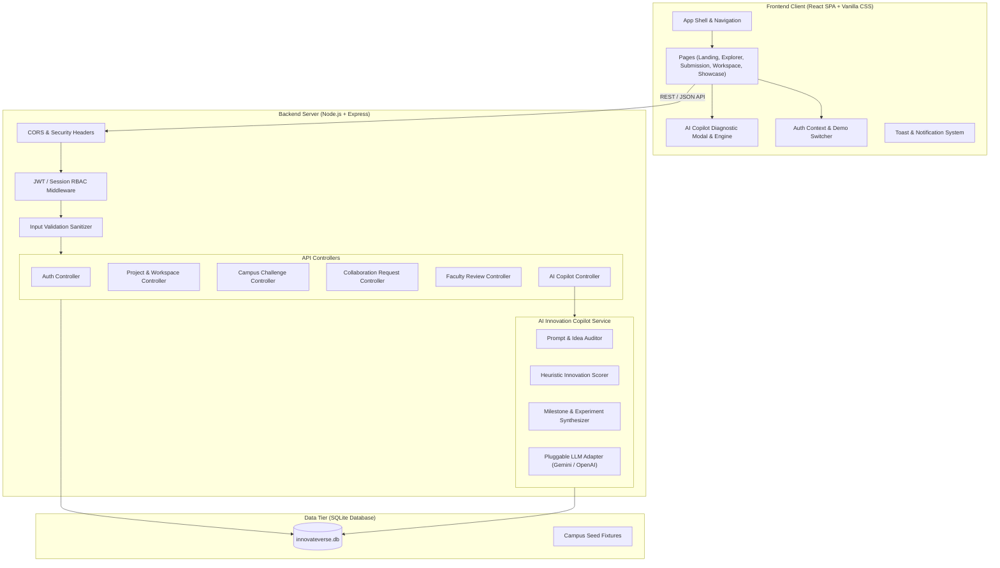
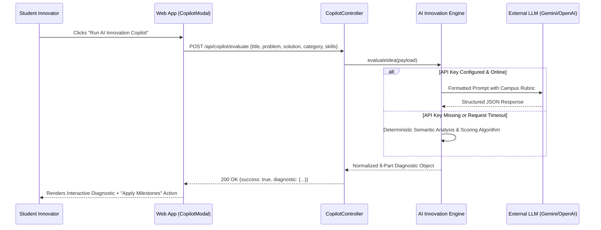

# Architecture Specification Document
## INNOVATEVERSE: AI-Powered Campus Innovation Platform
**Version:** 1.0.0  
**Stack:** React 18+ (Vite) + Vanilla CSS Design System + Node.js (Express) + SQLite3 / Better-SQLite3

---

### 1. High-Level Architecture Overview

The InnovateVerse platform is engineered as a decoupled full-stack web application designed for high responsiveness, sub-second query latency, security, and offline resilience during hackathon judging.



---

### 2. Frontend Architecture

#### 2.1 Technology Selection
- **Core Framework:** React 18+ via Vite for blazing fast HMR and optimized production bundles.
- **Styling Architecture:** Pure custom **Vanilla CSS** with a comprehensive design system token set in `src/styles/design-tokens.css` and `src/styles/index.css`. No heavy external utility frameworks; ensures 100% control over editorial dark theme, precision typography, layered elevations, and accessibility focus rings.
- **Icons:** Inline optimized SVG icon primitives (`src/components/icons.jsx`) for zero extra bundle overhead, crisp rendering, and theme responsiveness.

#### 2.2 Component Hierarchy & Structure
```
src/
├── assets/                  # High-res logos, challenge illustrations
├── components/              # Reusable UI primitives
│   ├── Navbar.jsx           # Editorial app header with session status & mobile drawer
│   ├── Footer.jsx           # Campus innovation platform footer
│   ├── ProjectCard.jsx      # Multi-stage project card with skills tags
│   ├── ChallengeCard.jsx    # Campus challenge card with sponsor metadata
│   ├── CopilotModal.jsx     # AI Innovation Copilot interactive diagnostic dialog
│   ├── DemoBanner.jsx       # Instant persona switcher (Student, Contributor, Mentor, Admin)
│   ├── MilestoneList.jsx    # Interactive milestone task checklist
│   ├── ReviewModal.jsx      # Faculty 4-point rubric review submission
│   ├── CollabModal.jsx      # Team application pitch modal
│   └── Toast.jsx            # Dynamic non-blocking feedback notifications
├── context/
│   ├── AuthContext.jsx      # User profile, role state, login/logout, demo switcher
│   └── ToastContext.jsx     # Global alert toast dispatch system
├── pages/
│   ├── LandingPage.jsx      # Editorial landing hero, lifecycle, challenges, featured
│   ├── ExplorerPage.jsx     # Search, filter chips, stage tabs, project grid
│   ├── SubmitIdeaPage.jsx   # 4-stage guided form with auto-draft & instant AI preview
│   ├── ProjectDetailsPage.jsx # Public/team view, open roles, mentor endorsements
│   ├── WorkspacePage.jsx    # Milestones, task board, collaborator management
│   ├── ShowcasePage.jsx     # Peer celebration, upvoting, showcase gallery
│   ├── ChallengesPage.jsx   # Institutional problem statements directory
│   └── ProfilePage.jsx      # Student skills, bio, owned and joined projects
├── services/
│   ├── api.js               # Centralized fetch client with token injection & error normalization
│   └── copilotService.js    # AI diagnostic trigger and response transformation
└── styles/
    ├── design-tokens.css    # Colors, fonts, elevation, borders, transitions
    └── index.css            # Base styles, typography, utility classes, components
```

---

### 3. Backend Architecture

#### 3.1 Technology Selection
- **Runtime:** Node.js (v20+ / v24+).
- **Web Framework:** Express.js with JSON body parser, CORS, and request logging.
- **Database Engine:** SQLite3 (file-based or in-memory fallback for zero-config portability).
- **Authentication:** Salted hash verification + JWT/Session bearer tokens.
- **Portability:** Self-contained server package that initializes its database schema and seeds realistic demonstration fixtures automatically on boot.

#### 3.2 Directory Structure
```
server/
├── config/
│   └── database.js          # SQLite connection and migration orchestrator
├── controllers/
│   ├── authController.js    # Register, login, me, demo-switch
│   ├── projectController.js # CRUD for projects, milestones, showcases
│   ├── challengeController.js # Campus challenges listing & linking
│   ├── collabController.js  # Apply, accept, reject collaboration requests
│   ├── reviewController.js  # Faculty rubric reviews & endorsements
│   └── copilotController.js # AI Innovation Copilot evaluation endpoint
├── middleware/
│   ├── auth.js              # Token verification & user attachment
│   ├── rbac.js              # Role-based authorization guards (requireRole)
│   └── validator.js         # Payload schema validation & XSS sanitization
├── services/
│   ├── aiEngine.js          # Heuristic + LLM hybrid innovation diagnostic
│   └── dbService.js         # Parameterized SQL query helper
├── seeds/
│   └── seedData.js          # Campus challenges, sample projects, milestones, users
└── server.js                # Express app bootstrapper
```

---

### 4. AI Innovation Copilot Architecture

The AI Copilot is the hallmark intelligence component of InnovateVerse. In a hackathon presentation, relying solely on an external API poses catastrophic risks (rate limits, network timeout, wifi disconnects). InnovateVerse solves this via a **Dual-Mode AI Engine**:



#### The 8-Part Diagnostic Schema:
```json
{
  "readinessScore": 84,
  "subScores": {
    "problemClarity": 88,
    "feasibility": 82,
    "impact": 90,
    "uniqueness": 76
  },
  "executiveSummary": "String",
  "targetPersonas": [
    { "name": "Campus Commuter", "painPoint": "40m wait times at North Gate" }
  ],
  "criticalAssumptions": [
    "Assumption 1: Bus drivers will accept tablet tracking",
    "Assumption 2: Peak load fits within cellular bandwidth"
  ],
  "leanMvpRecommendations": [
    "Omit real-time seat sensors in v1; use driver tap counts",
    "Deploy on PWA before building native iOS app"
  ],
  "suggestedTechStack": [
    { "layer": "Frontend", "tech": "React + Vite (PWA)" },
    { "layer": "IoT / Telemetry", "tech": "ESP32 + MQTT Broker" },
    { "layer": "Backend", "tech": "Node.js + TimescaleDB" }
  ],
  "immediateValidationExperiment": {
    "title": "3-Day Manual Headcount Experiment",
    "metric": "Verify whether 60%+ variance happens during 8:30 AM lecture rush"
  },
  "suggestedMilestones": [
    { "title": "Milestone 1: Paper Prototype & Student Polls", "targetDays": 7 },
    { "title": "Milestone 2: GPS Telemetry Breadboard Demo", "targetDays": 14 },
    { "title": "Milestone 3: Pilot Run with Shuttle #4", "targetDays": 21 },
    { "title": "Milestone 4: Campus Showcase & Grant Pitch", "targetDays": 28 }
  ]
}
```

---

### 5. Security & Threat Model

| Threat | Vulnerability Point | Implemented Defense |
|---|---|---|
| **SQL Injection** | Dynamic queries | 100% prepared statements with parameterized inputs (`db.prepare(...)`) |
| **Privilege Escalation** | Client-supplied role tampering | Role stored on user DB record, signed in JWT, validated on every mutating endpoint via `requireRole(...)` |
| **Cross-Site Scripting (XSS)** | User submissions rendering in DOM | React automatic JSX escaping + backend string sanitization striping malicious script payloads |
| **Unauthorized Project Mutation** | Editing someone else's workspace | Workspace actions check `WHERE project_id = ? AND owner_id = ?` or verify membership table |
| **Credential Compromise** | Storing plain passwords | Passwords hashed using standard cryptographic PBKDF2 / SHA-256 with user-specific salts |
| **API Denial of Service** | Rapid brute-force spam | Express rate limiter middleware limiting submission and copilot endpoints |
