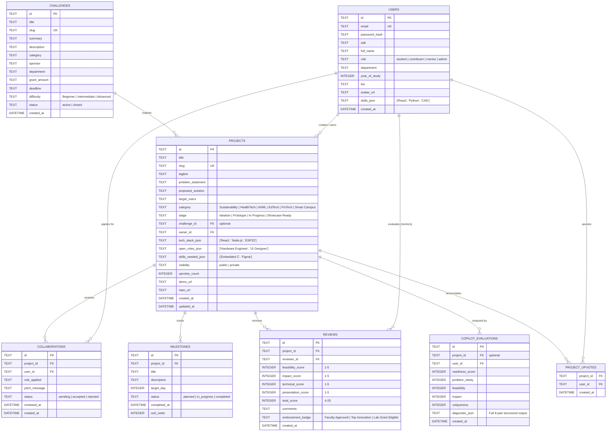

# Database Design Specification
## INNOVATEVERSE: AI-Powered Campus Innovation Platform
**Engine:** SQLite3 / Relational Schema with Foreign Keys Enforced  
**Version:** 1.0.0

---

### 1. Entity-Relationship Model



---

### 2. Table Specifications & DDL

```sql
-- Enforce Foreign Key Integrity
PRAGMA foreign_keys = ON;

-- 1. USERS TABLE
CREATE TABLE IF NOT EXISTS users (
    id TEXT PRIMARY KEY,
    email TEXT UNIQUE NOT NULL,
    password_hash TEXT NOT NULL,
    salt TEXT NOT NULL,
    full_name TEXT NOT NULL,
    role TEXT CHECK(role IN ('student', 'contributor', 'mentor', 'admin')) NOT NULL DEFAULT 'student',
    department TEXT NOT NULL,
    year_of_study INTEGER DEFAULT 1,
    bio TEXT,
    avatar_url TEXT,
    skills_json TEXT DEFAULT '[]',
    created_at DATETIME DEFAULT CURRENT_TIMESTAMP,
    updated_at DATETIME DEFAULT CURRENT_TIMESTAMP
);

CREATE INDEX IF NOT EXISTS idx_users_email ON users(email);
CREATE INDEX IF NOT EXISTS idx_users_role ON users(role);

-- 2. CAMPUS CHALLENGES TABLE
CREATE TABLE IF NOT EXISTS challenges (
    id TEXT PRIMARY KEY,
    title TEXT NOT NULL,
    slug TEXT UNIQUE NOT NULL,
    summary TEXT NOT NULL,
    description TEXT NOT NULL,
    category TEXT NOT NULL,
    sponsor TEXT NOT NULL,
    department TEXT NOT NULL,
    grant_amount TEXT,
    deadline TEXT,
    difficulty TEXT CHECK(difficulty IN ('Beginner', 'Intermediate', 'Advanced')) DEFAULT 'Intermediate',
    status TEXT CHECK(status IN ('active', 'closed')) DEFAULT 'active',
    created_at DATETIME DEFAULT CURRENT_TIMESTAMP
);

CREATE INDEX IF NOT EXISTS idx_challenges_category ON challenges(category);
CREATE INDEX IF NOT EXISTS idx_challenges_status ON challenges(status);

-- 3. PROJECTS TABLE
CREATE TABLE IF NOT EXISTS projects (
    id TEXT PRIMARY KEY,
    title TEXT NOT NULL,
    slug TEXT UNIQUE NOT NULL,
    tagline TEXT NOT NULL,
    problem_statement TEXT NOT NULL,
    proposed_solution TEXT NOT NULL,
    target_users TEXT,
    category TEXT CHECK(category IN ('Sustainability', 'HealthTech', 'AI/ML', 'EdTech', 'FinTech', 'Smart Campus')) NOT NULL,
    stage TEXT CHECK(stage IN ('Ideation', 'Prototype', 'In Progress', 'Showcase Ready')) NOT NULL DEFAULT 'Ideation',
    challenge_id TEXT REFERENCES challenges(id) ON DELETE SET NULL,
    owner_id TEXT NOT NULL REFERENCES users(id) ON DELETE CASCADE,
    tech_stack_json TEXT DEFAULT '[]',
    open_roles_json TEXT DEFAULT '[]',
    skills_needed_json TEXT DEFAULT '[]',
    visibility TEXT CHECK(visibility IN ('public', 'private')) DEFAULT 'public',
    upvotes_count INTEGER DEFAULT 0,
    demo_url TEXT,
    repo_url TEXT,
    created_at DATETIME DEFAULT CURRENT_TIMESTAMP,
    updated_at DATETIME DEFAULT CURRENT_TIMESTAMP
);

CREATE INDEX IF NOT EXISTS idx_projects_category ON projects(category);
CREATE INDEX IF NOT EXISTS idx_projects_stage ON projects(stage);
CREATE INDEX IF NOT EXISTS idx_projects_owner ON projects(owner_id);
CREATE INDEX IF NOT EXISTS idx_projects_challenge ON projects(challenge_id);

-- 4. MILESTONES TABLE
CREATE TABLE IF NOT EXISTS milestones (
    id TEXT PRIMARY KEY,
    project_id TEXT NOT NULL REFERENCES projects(id) ON DELETE CASCADE,
    title TEXT NOT NULL,
    description TEXT,
    target_day INTEGER DEFAULT 7,
    status TEXT CHECK(status IN ('planned', 'in_progress', 'completed')) DEFAULT 'planned',
    completed_at DATETIME,
    sort_order INTEGER DEFAULT 0
);

CREATE INDEX IF NOT EXISTS idx_milestones_project ON milestones(project_id);

-- 5. COLLABORATION REQUESTS TABLE
CREATE TABLE IF NOT EXISTS collaborations (
    id TEXT PRIMARY KEY,
    project_id TEXT NOT NULL REFERENCES projects(id) ON DELETE CASCADE,
    user_id TEXT NOT NULL REFERENCES users(id) ON DELETE CASCADE,
    role_applied TEXT NOT NULL,
    pitch_message TEXT NOT NULL,
    status TEXT CHECK(status IN ('pending', 'accepted', 'rejected')) DEFAULT 'pending',
    reviewed_at DATETIME,
    created_at DATETIME DEFAULT CURRENT_TIMESTAMP,
    UNIQUE(project_id, user_id, role_applied)
);

CREATE INDEX IF NOT EXISTS idx_collab_project ON collaborations(project_id);
CREATE INDEX IF NOT EXISTS idx_collab_user ON collaborations(user_id);

-- 6. FACULTY & MENTOR REVIEWS TABLE
CREATE TABLE IF NOT EXISTS reviews (
    id TEXT PRIMARY KEY,
    project_id TEXT NOT NULL REFERENCES projects(id) ON DELETE CASCADE,
    reviewer_id TEXT NOT NULL REFERENCES users(id) ON DELETE CASCADE,
    feasibility_score INTEGER CHECK(feasibility_score BETWEEN 1 AND 5) NOT NULL,
    impact_score INTEGER CHECK(impact_score BETWEEN 1 AND 5) NOT NULL,
    technical_score INTEGER CHECK(technical_score BETWEEN 1 AND 5) NOT NULL,
    presentation_score INTEGER CHECK(presentation_score BETWEEN 1 AND 5) NOT NULL,
    total_score INTEGER NOT NULL,
    comments TEXT NOT NULL,
    endorsement_badge TEXT,
    created_at DATETIME DEFAULT CURRENT_TIMESTAMP
);

CREATE INDEX IF NOT EXISTS idx_reviews_project ON reviews(project_id);

-- 7. AI COPILOT EVALUATIONS TABLE
CREATE TABLE IF NOT EXISTS copilot_evaluations (
    id TEXT PRIMARY KEY,
    project_id TEXT REFERENCES projects(id) ON DELETE CASCADE,
    user_id TEXT NOT NULL REFERENCES users(id) ON DELETE CASCADE,
    readiness_score INTEGER NOT NULL,
    problem_clarity INTEGER NOT NULL,
    feasibility INTEGER NOT NULL,
    impact INTEGER NOT NULL,
    uniqueness INTEGER NOT NULL,
    diagnostic_json TEXT NOT NULL,
    created_at DATETIME DEFAULT CURRENT_TIMESTAMP
);

CREATE INDEX IF NOT EXISTS idx_copilot_project ON copilot_evaluations(project_id);

-- 8. PROJECT UPVOTES TABLE
CREATE TABLE IF NOT EXISTS project_upvotes (
    project_id TEXT NOT NULL REFERENCES projects(id) ON DELETE CASCADE,
    user_id TEXT NOT NULL REFERENCES users(id) ON DELETE CASCADE,
    created_at DATETIME DEFAULT CURRENT_TIMESTAMP,
    PRIMARY KEY(project_id, user_id)
);
```

---

### 3. Data Integrity & Migration Strategy

1. **Auto-Initialization:** On server startup, `server/config/database.js` runs `CREATE TABLE IF NOT EXISTS` commands and validates schema indexes.
2. **Realistic Seed Fixtures:** If the `projects` table count is zero, the database seeds:
   - 4 Pre-configured personas:
     - Maya Lin (Student Lead, 2nd Year CS)
     - Alex Rivera (Team Contributor, 3rd Year IoT / MechE)
     - Dr. Sarah Rao (Faculty Mentor, CS & Robotics)
     - Marcus Vance (Campus Innovation Center Director / Admin)
   - 4 High-impact Campus Challenges (Smart Campus Transit, Dining Hall Food Waste, Campus Solar Microgrid, Peer Academic Assist)
   - 6 Varied projects across categories and stages with real milestones and collaboration needs
   - Sample faculty reviews with realistic scores and endorsements.
